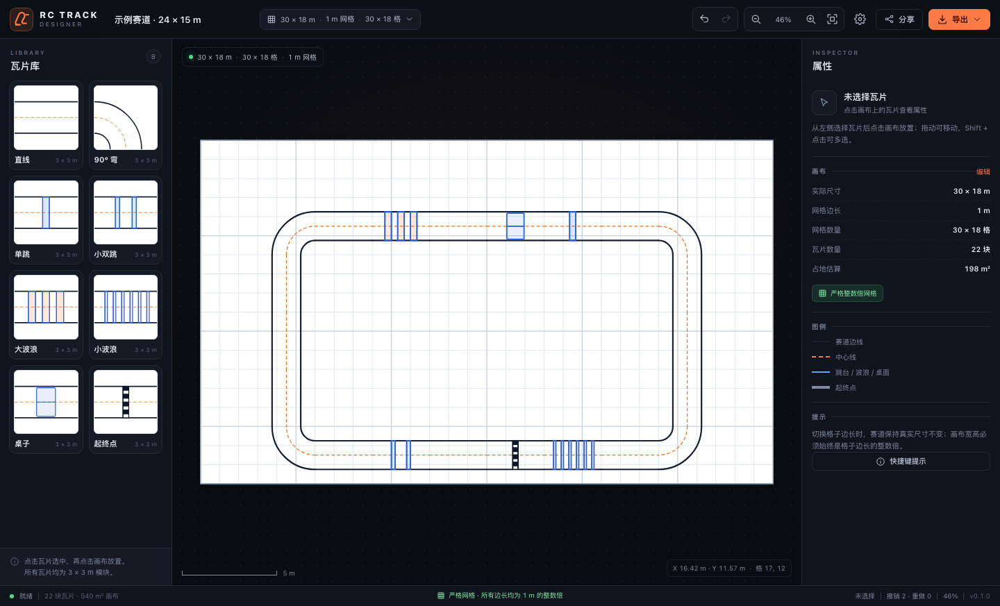

# RC Track Designer

桌面网页版 RC 赛道网格设计器。物理尺寸优先、严格整数倍网格，支持 PNG / PDF / DXF / 分享链接四种输出。



---

## 快速开始

```bash
pnpm install
pnpm dev
```

打开 `http://127.0.0.1:5173`。

生产构建与校验：

```bash
pnpm typecheck   # core + web 类型检查
pnpm test        # @rctrack/core 单测（21 用例）
pnpm build       # 产物在 apps/web/build/client
pnpm preview     # 本地预览构建产物
```

技术栈：React 19 + React Router 7（framework mode / SPA）+ TypeScript + Vite + Zustand + SVG。pnpm workspace 单仓多包，无后端，纯静态部署。

仓库结构：`apps/web`（编辑器，路由与 UI）+ `packages/core`（纯领域核心，可被 MCP/CLI 复用）。分层规则与迁移映射见 [docs/architecture.md](docs/architecture.md)。

---

## 已实现

### 画布与网格

- 正方形网格，格子边长 `0.3 / 0.5 / 1 m` 可选；
- 画布宽高可按 **米** 或 **格数** 双向设置；
- **硬性规则**：画布宽高必须是当前格子边长的整数倍，否则不能应用；
- 切换格子边长时，赛道瓦片保持原米坐标，不缩放、不移动；
- 画布扩大/缩小，缩小前提示会移除多少块瓦片，可撤销；
- 网格线用单条 SVG path 渲染，不是一格一个 DOM；
- 平移/缩放/适配画布。

### 瓦片与编辑

- 8 种 3 × 3 m 模块：直线、90° 弯、单跳、小双跳、大波浪、小波浪、桌子、起终点；
- 点击选中瓦片，再点击画布放置；
- 拖动移动、`R` 旋转、`F` 翻转、`Delete` 删除；
- Shift + 点击多选，批量旋转/翻转/删除/复制；
- 撤销/重做（最多 80 步）；
- 自动保存到 localStorage，刷新恢复；
- JSON 导入/导出；
- 示例赛道一键载入。

### 四种输出

| 输出 | 说明 |
|---|---|
| 分享链接 | 文档压缩到 URL `#` 后，纯静态；打开是只读预览，可复制到本地 |
| PNG | 2× 位图，默认无网格，适合快速展示；支持复制到剪贴板 |
| PDF | A4 自动横竖，300 DPI 位图，标题/比例尺/图例/页脚 |
| DXF | 2D 草图，单位毫米；R12（3ds Max）与 R2000（Fusion/CAD）两种版本 |

---

## 网格模型：物理优先

这是整个工具最重要的设计决策。

- 米是事实来源；
- 格子只是吸附/显示网格；
- 瓦片有真实尺寸（当前全部 3 × 3 m）；
- 改格子边长不改变赛道，只改变网格密度。

例子：

```text
画布 30 × 18 m，3m 瓦片

1m 网格：30 × 18 格，瓦片占 3 × 3 格
0.3m 网格：100 × 60 格，瓦片占 10 × 10 格
赛道几何：完全不变
```

严格校验：

```ts
isMultiple(widthM, cellSize) && isMultiple(heightM, cellSize)
```

不满足时：

- “应用设置”按钮禁用；
- 显示最近合法值，例如 `30.1m` 在 `1m` 网格下提示 `30m / 31m`；
- 可以一键取最近合法值，但仍然需要用户确认应用。

实现位置：[`packages/core/src/geometry.ts`](packages/core/src/geometry.ts)、[`apps/web/app/components/BoardSettingsModal.tsx`](apps/web/app/components/BoardSettingsModal.tsx)。

---

## 数据模型

```ts
interface TrackDoc {
  schemaVersion: 1;
  name: string;
  board: {
    cellSize: 0.3 | 0.5 | 1;
    widthM: number;
    heightM: number;
  };
  tiles: PlacedTile[];
  meta: { createdAt: string; updatedAt: string };
  tileSetVersion: string;
}

interface PlacedTile {
  uid: string;
  defId: string;
  xM: number;
  yM: number;
  rotation: 0 | 90 | 180 | 270;
  flipX: boolean;
  flipY: boolean;
  layer: number;
}
```

- 稀疏存储，不存二维数组；
- 占位/碰撞在米坐标系计算；
- 瓦片几何用 `Primitive`（line/rect/arc/circle/polyline）描述，SVG 与 DXF 共用；
- 所有坐标保留 3 位小数。

---

## DXF 说明

- 单位：毫米，1 m = 1000 单位；
- 画布左下角为原点，Y 轴向上；
- 图层：
  - `BOARD` 画布边界
  - `GRID` 网格（默认不导出）
  - `TILE_OUTLINE` 瓦片边界
  - `TRACK_EDGE` 赛道边线
  - `TRACK_CENTER` 中心线
  - `FEATURE` 跳台/波浪/桌面
  - `START_FINISH` 起终点
  - `TEXT` 标题与尺寸
- 弧线导出为折线（约 5° 一段），保证各种 CAD 兼容；
- R12 用于 3ds Max；R2000 带 `$INSUNITS = 4`，用于 Fusion/CAD；
- R12 不支持 `$INSUNITS`，导入时如软件询问单位，请选 **毫米**；R2000 会自动识别毫米；
- 中文标题在 R12 中不可靠，非 ASCII 名称会回退为 `RC TRACK`；尺寸/网格/瓦片数在第二行文本中。

---

## 分享链接

```text
https://your-site/s/<deflate + base64url>
```

- 文档 JSON → `fflate` deflate → base64url；
- 分享数据不经过服务器；
- 打开后是只读预览，顶部“复制到本地”可继续编辑；
- 旧版 `#/s/<...>` 链接不会失效，打开后自动跳转到新地址；
- 当前 22 块瓦片的链接约 1.3 KB；
- 链接过长时提示先导出 JSON；
- 代码里已预留后续接短链服务的空间。

实现位置：编解码在 [`packages/core/src/share.ts`](packages/core/src/share.ts)，URL 与本地存储组装在 [`apps/web/app/lib/share.ts`](apps/web/app/lib/share.ts)。

---

## 目录结构

```text
apps/web/app/
  root.tsx                 HTML 骨架、首屏占位、错误边界
  routes.ts                路由表：/ · /s/:token · 404
  routes/                  页面入口（clientLoader 负责取数）
  components/              UI 部件 + EditorApp 编辑器外壳
  store/useStore.ts        文档、选择、历史、视口、Toast
  lib/share.ts             分享链接、localStorage、旧 hash 兼容
  lib/export/              PNG / PDF / DXF 下载封装
  styles.css               设计系统
packages/core/src/
  geometry.ts              物理优先网格、碰撞、严格校验
  tiles.ts / ports.ts      8 种瓦片几何与端口
  validate.ts              闭合校验与 Issue 码
  share.ts                 分享编解码（无 DOM）
  export/dxf.ts            DXF R12/R2000 字符串构建
docs/
  architecture.md         代码架构与分层规则
  feasibility.md          参考站分析
  spec-v1.md              v1 规格
  requirements-phase1.md  功能需求一期（FR-1）
  engineering.md          项目工程说明（仓库/部署/后端选型）
```

各层依赖是单向的：`apps/web` → `packages/core`，core 不允许依赖 DOM、React 或 Zustand。完整规则见 [docs/architecture.md](docs/architecture.md)。

---

## 已知限制

- 只适配桌面，触屏/移动端未优化；
- 闭环校验只支持单回路，8 字/立交（度数为 4）尚未支持；
- 没有多层/立交/高差；
- PDF 是位图，不是矢量；
- 分享链接是长 hash，没有短链服务；
- DXF 弧线是折线近似，不是真 ARC 实体；
- 中文 DXF 文本会回退英文；
- 没有 1:1 分页打印/BOM/CNC 导出。

这些都在 [docs/spec-v1.md](docs/spec-v1.md) 的路线图里；一期功能需求（端口、搭建图、DXF 双预设、MCP）见 [docs/requirements-phase1.md](docs/requirements-phase1.md)。

---

## 后续优先级

1. 端口吸附、起点方向、赛道长度统计；
2. 赛道长度/比例尺/BOM；
3. 1:1 分页打印；
4. 自定义瓦片/多层/立交；
5. 矢量 PDF、短链、云端项目、协作。

---

## 说明

本项目是 clean-room 实现：未复用参考站的图片、Logo、名称或代码。参考站的公开前端分析见 [docs/feasibility.md](docs/feasibility.md)。
